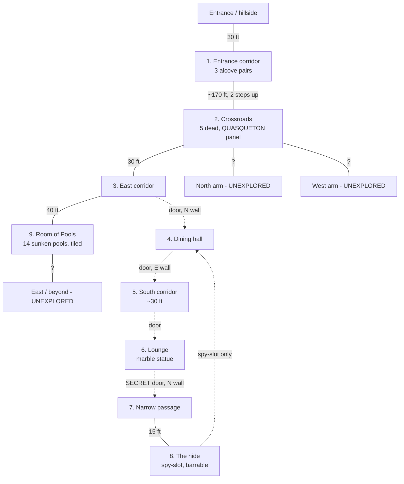

# Quasqueton — Known Map

Shared player/DM map of **discovered** geography only. Node numbering follows
`dlwork/B1_DL_notes.md`. Nothing unexplored is described here.

> **The extracted map outranks this file.** Where a distance or a connection here
> disagrees with `mapdb/output/b1/b1.sqlite`, the database is right and this note
> is wrong — ruled by the player 2026-08-25. Everything below was paced or
> remembered during play, mostly before the map existed.
>
> **Known wrong:** node 3's "70 ft to the Room of Pools" and "door to dining hall
> at 30 ft". The database makes the crossroads' east arm 30 ft long, turning
> south, and puts the Room of Pools 220 ft away by the shortest route. Query
> `dmap.py path` for any distance that matters.

## Nodes

| # | Place | Key features |
|---|---|---|
| 1 | **Entrance corridor** | 3 alcove pairs. 1st solid, **2nd = one-way secret doors** (see below), 3rd = **magic mouths** that shout on every pass. Floor churned by heavy traffic. Front door **cannot be barred** (brackets empty). |
| 2 | **Crossroads** | Two steps up from corridor 1. **Five dead** — 3 outsiders (fighter, magic-user, dwarf), 2 guards. All stripped of armour. **Wooden panel in W wall, "QUASQUETON" carved, blood-stained.** Panel sounds solid, no mechanism found. |
| 3 | **East corridor** | Runs E from crossroads. Door to dining hall in N wall at 30 ft. Ends at broad opening to Room of Pools at 70 ft. |
| 4 | **Dining hall** | Maple furniture, several overturned. Carved mantle at 7 ft. **Two walnut thrones fused into NE wall — confirmed solid.** Searched clean. **Spy-slot high in S wall** (from node 8). |
| 5 | **South corridor** | ~30 ft, no side openings, clean floor. |
| 6 | **Lounge** | Benches facing centre. **Marble statue carved from living rock — worth thousands, immovable.** Tankards, dry keg. Searched clean. |
| 7 | **Narrow passage** | 5 ft wide, 15 ft long. Dust was **undisturbed** — never found by previous looters. E wall confirmed solid. |
| 8 | **The hide** | 20×25. Bedroll, shelf, **hundreds of tally marks** by the slot. **Iron drop-bar on the inside.** Spy-slot overlooks node 4. **Designated rest site.** |
| 9 | **Room of Pools** | Enormous. Mosaic tile floor. **14 sunken pools**, ~10 ft across, each different — one runs **warm**, one runs **colder than stone**. Only west end scouted, by infravision. |

## Edges

| From | To | Distance | Door |
|---|---|---|---|
| Outside | 1 | 30 ft | Wooden, **forced long ago, unbarrable**, groans loudly |
| 1 | 2 | ~170 ft | open, two steps up at N end |
| 2 | 3 | 30 ft | open |
| 3 | 4 | — | **Locked** (Tristle picked it). Opens **into corridor 3**. Hinges **oiled** |
| 3 | 9 | 40 ft E of the hall door | Broad open archway, 10 ft |
| 4 | 5 | — | **Locked** (Tristle picked it). Hinges **oiled** |
| 5 | 6 | 30 ft | Unlocked. Opens **into the lounge**. Hinges **oiled** |
| 6 | 7 | — | **Secret**, catch on lounge side, **plain lever + bar on hide side** |
| 7 | 8 | 15 ft | open |

| 10 | **Advisor's Chamber** | Marevak's room, reached **only** by a secret door in the Room of Pools' east wall (north third). Mosaic floor. Bed, chairs, table, desk. **Desk drawer was gas-trapped — trap now spent.** Drawer picked open: **empty**. Elvish notes by Marevak, no maps, no use. **PAINTING of Rogahn & Zelligar cached here — 300 gp.** One entrance, spikeable, unknown to the dungeon — **best rest site found.** |
| 11 | **South corridor** | Through the Room of Pools' south door. Runs **east–west**, 10 ft wide. Dust lightly marked — used. Faint damp, earthy smell. **Both directions unexplored.** |

## Room of Pools (9) — fully surveyed

~80 ft square, mosaic tile floor, **14 sunken pools** ~10 ft across, each holding something
different. One reads **warm**, one **bitterly cold**. **No pool has been touched or tested.**

| Wall | Status |
|---|---|
| West | broad 10 ft opening to node 3 |
| North | **solid, all thirds confirmed** |
| East | south & middle solid; **secret door to node 10** in the north third |
| South | **door to node 11** |

## Open leads

1. **Crossroads north arm** — untouched
2. **Crossroads west arm** — untouched
3. **Room of Pools** — only the west end seen; no far wall found, no exits identified
4. **The QUASQUETON panel** — sounds solid, no mechanism found, not yet forced
5. Where the troglodyte in the Room of Pools was **walking to** — it came from the east end
   of node 9 and was heading west past the crossroads when it doubled back

## Standing facts

- **Magic mouths announce every entry and exit** through node 1. Unavoidable on the way out.
- Something **scavenges the dead at night** — bodies at the crossroads and our own kills were
  picked over between day 1 and day 2. A troglodyte was carrying a human-sized gold ring.
- **Node 8 is the only defensible rest site found.** Concealed, barrable, overlooks our
  retreat route.

---

## Expedition 3 — the south corridor, west arm *(round 190-205)*

Leaving Rogahn's Chamber westward with the tapestries. Marching order: Dave and
Torsat front, Tristle and Frython middle, Blartho and Yrtone rear. Party at
**6" — 60 ft per turn** (see `rules/exploration.md`), everyone but Torsat carrying.

| # | Place | Key features |
|---|---|---|
| 12 | **Rogahn's Chamber** | Irregular lobed chamber. **Four tapestries** taken, 100 gp each, 600 gp weight each. Two ways out on the west side. |
| 13 | **South corridor, west arm** | Runs west from Rogahn's Chamber. 60 ft brings it back to the Room of Pools' south door; known ground ended there. A **door in the north wall** and a **door in the south wall** passed on the way. **Opening in the north wall** 30 ft west of the Pools door. |
| 14 | **The crossing** | 20 ft further west. Openings **north and south**, both unexplored. |
| 15 | **West dead end** | 10 ft past the crossing. Searched: a **one-way secret door** in the west wall — a slab set slightly proud, joint floor to ceiling, hand-hold cut at chest height. Obvious from this side; the module makes it unnoticeable only from the entrance-corridor face. **It is the back of alcove pair 2.** Through it and south is **130 ft to the entrance**; the long way round is **280 ft**. |
| 16 | **Alcove pair 2, from behind** | The one-way door opens onto the **east alcove of pair 2**, in the entrance corridor. Coming out here puts you **below the magic mouths** (pair 3) — going south you pass only pair 1, which is solid. **The mouths do not fire on the way out.** |
| — | **Alcove pair 2, current state** | The **east** alcove's door (map edge `17,13,V`) is **spiked open**, two iron spikes at the bottom, left that way at the end of expedition 3. It is the same door the party spiked **shut** from the corridor side back in expedition 1; Tristle reopened it from the dead-end side. The state of record is `campaign/world_changes.tsv`, not this table — run `python tools/world.py state --level 1`. |
| 17 | **Throne Room** | Off the y=13 corridor by a door in its south wall, then 20 ft of passage. **60 ft by 40**, slate floor, **eight red granite pillars** in two ranks of four flanking a central lane. Across the east end a **raised dais** of red granite, two steps up, with **two enormous white marble thrones** on it facing west, and **yellow-and-purple draperies** the full height of the east wall behind them. Draperies searched: plain wall behind, nothing. Thrones searched: nothing. **A recess under the north lip of the dais held a plain metal ring — UNIDENTIFIED.** Eight pillars NOT searched. Ways out: north passage (how we came), **north-west opening**, **door mid-west-wall**, **south-west opening**, and a **passage running south** from the SW corner with a door 20 ft down its west side. One troglodyte came out of the north-west opening at round 64. |
| 18 | **Secret door, throne room NE corner** | In the **north wall** of the throne room's north-east corner. Tristle spotted the seam just walking past it. **It opens into Rogahn's Chamber** — the two are back to back. Examined round 81: pivots on its west edge and **swings away from the throne room, northward**; a shallow hand-hold is cut into the throne-room face at chest height, the same signature as the pair-2 doors and the west dead end. Not yet opened. |
| — | **Secret doors, DM-side** | Six now placed on level 1. The party has found only the Advisor's Chamber door (node 10). |
| — | **Berserkers** | Two, out of the crossing's **south** arm at round 224, carrying no light. Both killed. They **never check morale** (MM) — they do not break. Dave was dropped to −1 in round 1. |
